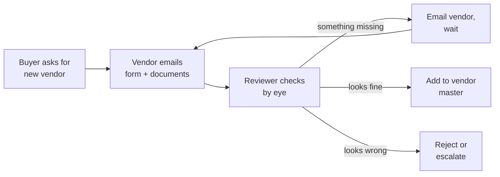
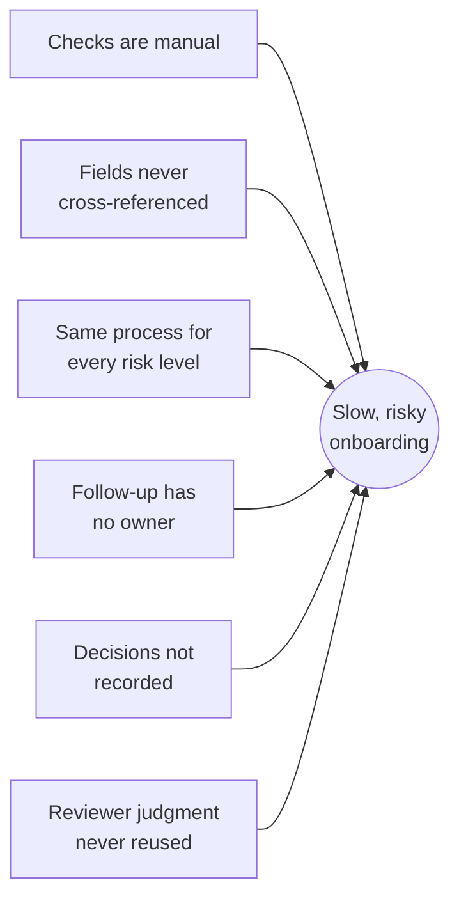
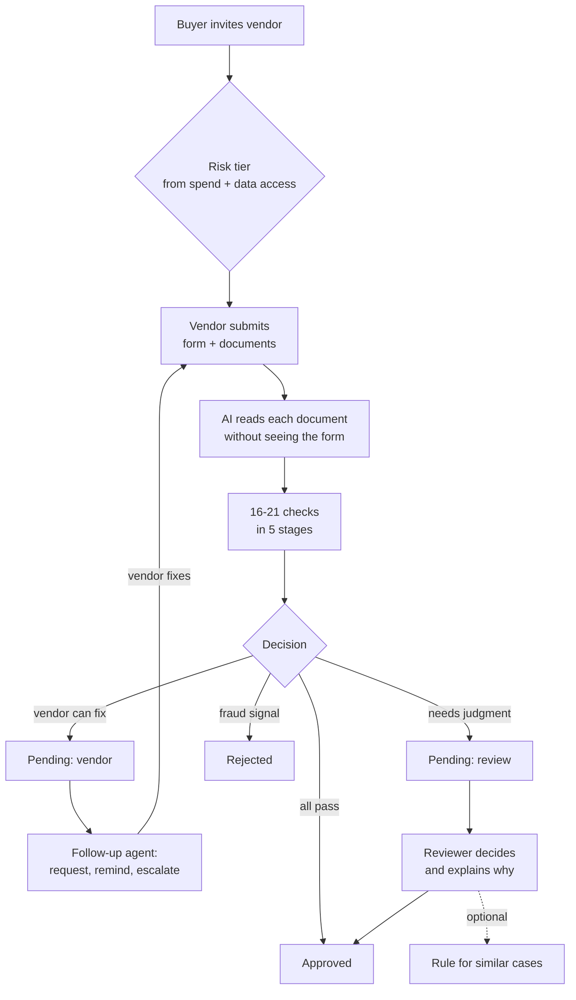
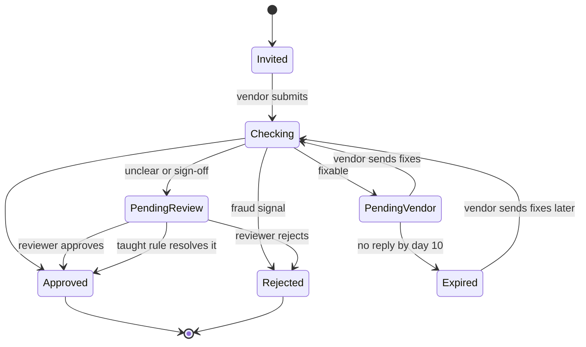
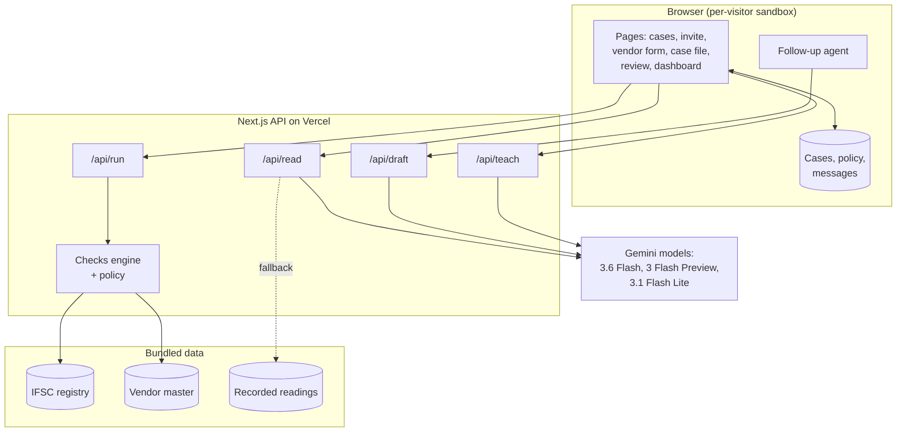
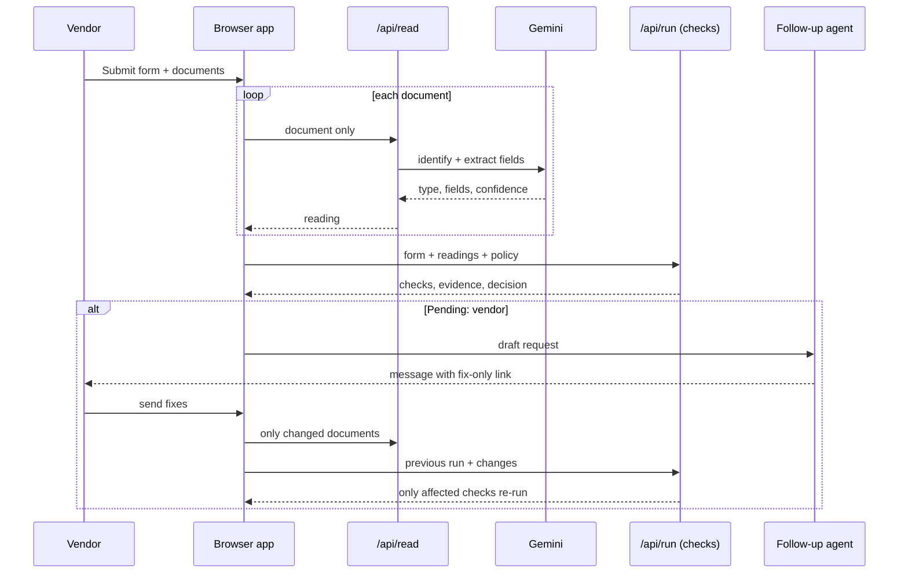
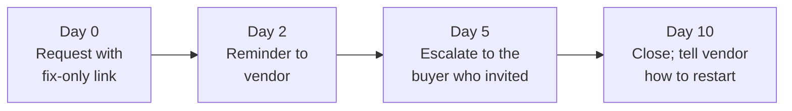
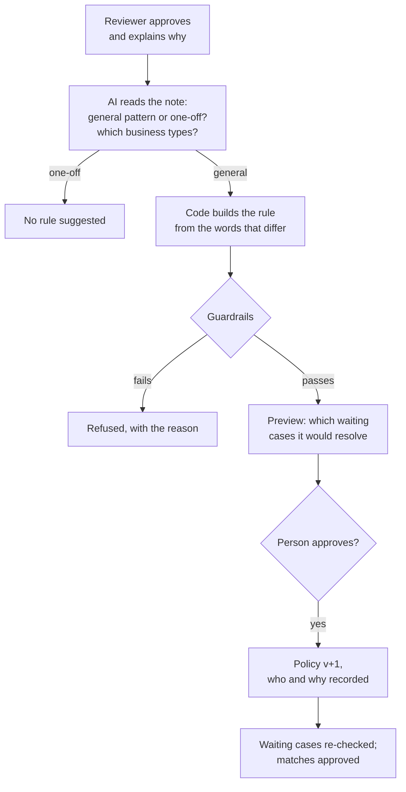
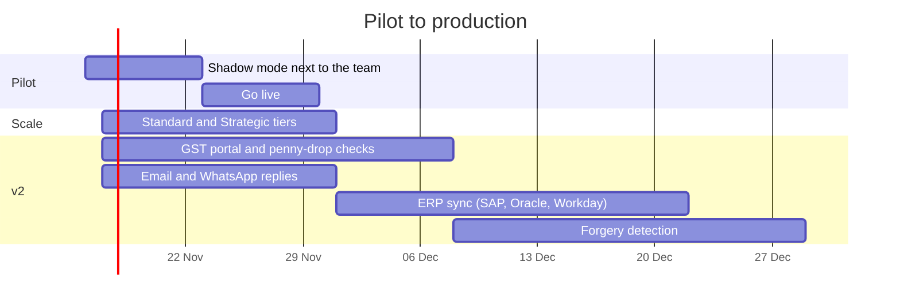

# Vendor Onboarding: from submission to approval

**Live app:** https://vendor-onboarding-gules-three.vercel.app/ · **Case study:** AI Solutions Analyst, problem statement 2

## 1. Executive summary

Before a company pays a new vendor, someone has to confirm the vendor is who they say they are. Today that check is manual, the follow-up happens over email, and the most dangerous problems only show up when fields are cross-referenced by hand.

This project is a working onboarding process that takes a vendor's form and documents and returns **Approved**, **Pending** or **Rejected**, with every reason visible. AI reads the documents; plain, auditable code makes every decision; anything the vendor can fix goes back to them automatically and is chased until it's resolved; anything unclear goes to a person, who can teach the process a rule for next time, inside guardrails that no rule can relax.

On 23 test documents, the AI identified every document type and read 75 of 76 fields correctly (98.7%), at 6.5 seconds per document. All 9 sample vendors, including five fraud and failure scenarios, reach the expected decision from real AI readings. 48 automated tests cover the checks, the fix loop, the teaching and the guardrails.

---

## 2. The problem

### 2.1 How it works today



Every arrow is a person. The loop between "check" and "email vendor" can run several times, and the record of what was asked and why lives in someone's inbox.

### 2.2 Where it breaks

| Symptom (from the brief) | What it looks like in India | Why it's hard to catch by hand |
|---|---|---|
| Incomplete forms | No cancelled cheque, no PAN card | Easy to spot, slow to chase |
| Wrong documents attached | An invoice uploaded as the GST certificate | Reviewer has to open every file |
| Name doesn't match the bank account | Bank account "Sharma Traders", registered as "Sharma Trading Co." | Sometimes legitimate, sometimes fraud: needs judgment |
| Tax ID format wrong for the country | A UK vendor enters an Indian GSTIN | Format rules differ by country |
| Subtle cross-field inconsistencies | A GSTIN that passes its check digit but contains another company's PAN | Only visible when two fields are compared character by character |
| Manual follow-up | Reminders depend on someone remembering | No schedule, no escalation |
| Inbox as audit trail | "Why did we approve this vendor?" | No record of evidence or reasoning |

### 2.3 Root causes



The last cause matters most for scale: when a reviewer decides that "Traders" and "Trading Co." are the same business for sole proprietors, that judgment is lost. The next identical case needs a person again.

### 2.4 Business risk

- **Payment fraud.** A fake vendor with a borrowed GSTIN or a bank account belonging to someone else gets paid.
- **Compliance.** GST input credit and audit trails depend on correct vendor tax registration.
- **Slow activation.** Good vendors wait while forms bounce back and forth, and buyers work around procurement.

---

## 3. Stakeholders

| Stakeholder | What they need | What this process gives them |
|---|---|---|
| Buyer (procurement) | Vendor active quickly, without chasing | Invite in one step; escalation only if the vendor goes quiet |
| Vendor | Know exactly what's wrong, fix only that | A fix page listing only the items to change |
| Reviewer (AP / finance) | Only see cases that need judgment | Review queue with evidence side by side; can teach a rule |
| Finance controller | No payments to the wrong party | Fraud checks that can't be overridden; risk-based tiers |
| Auditor | Why each vendor was approved | Every check, its evidence, every message and every rule change, with who and why |

---

## 4. Design principles and key decisions

**AI reads. Code decides. People teach.**

| Decision | Options considered | Choice | Why |
|---|---|---|---|
| Who makes the decision | LLM decides / code decides | **Code decides** | Finance needs the same input to give the same answer, and every rejection to name its check and evidence. |
| What the AI sees | Document + form / document only | **Document only** | If the AI sees what the vendor typed, it tends to confirm it. Reading blind makes a mismatch real evidence. |
| How much checking | Same for all / by risk | **Risk tiers set at invite** | A ₹3L stationery vendor and a ₹2.4 Cr analytics vendor with data access carry different risk. |
| Handling grey areas | Manual every time / fixed rules / taught rules | **Taught rules, with guardrails and human approval** | Reuses reviewer judgment without letting anyone relax a fraud check. |
| When the AI fails | Fail the case / guess / route to a person | **Route to a person** | An unread document is the AI's problem, not evidence against the vendor. |
| Resubmissions | Re-run everything / only what changed | **Only affected checks re-run** | Faster, and the reviewer sees exactly what changed. |
| Demo state | Shared database / per-visitor sandbox | **Per-visitor sandbox** | Several reviewers can use the live link at once without one person's rule changing another's demo. Production would use a database. |
| AI outage | Fail / retry one model / fallback chain | **3 models, 25 s limit each, then a recorded reading** | The live demo can't break on a busy model. |

---

## 5. The to-be process



---

## 6. Decision logic

### 6.1 The rule

1. Any **integrity problem** → **Rejected**. These can't be overridden by hand or by a taught rule.
2. Anything the **vendor can fix** → **Pending: vendor**, with a message listing exactly what to change.
3. Anything that **needs judgment** → **Pending: review**.
4. **Strategic** vendor with everything passing → **Pending: review** for a sign-off.
5. Otherwise → **Approved**, and the vendor joins the vendor master so later vendors are checked against them.

### 6.2 Risk tiers

| Tier | When | Documents | Approval |
|---|---|---|---|
| Low | Under ₹5L a year, no data access | GST certificate, cancelled cheque | Automatic if all checks pass |
| Standard | ₹5L to ₹1 Cr | + PAN card | Automatic if all checks pass |
| Strategic | Over ₹1 Cr, or access to data or systems | + Certificate of incorporation | A person always signs off |

Outside India, a bank letter replaces the cancelled cheque and GST/PAN documents aren't required.

### 6.3 Every check

| Stage | Check | What it catches | Severity → reason code |
|---|---|---|---|
| Completeness | Required fields | Empty form fields | Vendor fix → `FIELD_MISSING` |
| Completeness | Required documents for the tier | Missing upload | Vendor fix → `DOC_MISSING` |
| Documents | Right type and readable (per document) | Invoice uploaded as GST certificate; blurry photo; AI unavailable | Vendor fix → `DOC_WRONG_TYPE`, `DOC_UNREADABLE`; Review → `DOC_NOT_READ_AI` |
| Format | GSTIN format and check digit | Typos (official base-36 algorithm) | Vendor fix → `GSTIN_INVALID` |
| Format | Tax ID fits the country | UK vendor entering a GSTIN; bad VAT or EIN | Vendor fix → `TAX_ID_FORMAT` |
| Format | PAN format and holder type | PAN of an individual for a "Private Limited Company" | Vendor fix → `PAN_INVALID`; Review → `PAN_TYPE_MISMATCH` |
| Format | IFSC is a real branch of the stated bank | Made-up or mistyped IFSC (176,918 branches, offline) | Vendor fix → `IFSC_INVALID`, `IFSC_BANK_MISMATCH` |
| Format | IBAN / US routing checksum | Mistyped international bank details | Vendor fix → `IBAN_INVALID`, `ROUTING_INVALID` |
| Format | Account number, CIN format | Malformed numbers | Vendor fix → `ACCOUNT_INVALID`, `CIN_INVALID` |
| Cross-reference | PAN inside GSTIN = PAN given | GSTIN registered to another legal entity | **Fraud → `GSTIN_PAN_MISMATCH`** |
| Cross-reference | GSTIN state = address state | Registration in another state | Review → `GSTIN_STATE_MISMATCH` |
| Cross-reference | Documents match the form | Certificate or PAN card in another name; different numbers | **Fraud → `DOC_NAME_MISMATCH`**; Review → `DOC_NAME_NEAR_MATCH`, `DOC_GSTIN_MISMATCH`, `DOC_PAN_MISMATCH`, `DOC_COI_MISMATCH`, `DOC_FIELD_NOT_READ` |
| Cross-reference | Cheque matches bank details | Typo in account number | Vendor fix → `DOC_BANK_MISMATCH` |
| Cross-reference | Bank account holder is the vendor | Payments going to a third party | **Fraud → `BANK_NAME_MISMATCH`**; Review → `BANK_NAME_NEAR_MATCH` |
| Fraud screen | Bank account not used by another vendor | Classic fake-vendor pattern | **Fraud → `BANK_ACCOUNT_SHARED`** |
| Fraud screen | GSTIN / PAN not on file for another vendor | Borrowed identity; duplicate vendor | **Fraud → `GSTIN_BELONGS_TO_OTHER_VENDOR`, `PAN_BELONGS_TO_OTHER_VENDOR`**; Review → `DUPLICATE_VENDOR` |

### 6.4 Lifecycle of a case



---

## 7. Solution architecture

### 7.1 Components



| Component | Responsibility | AI? |
|---|---|---|
| `/api/read` | Identify each document and read its fields, without the form | Yes: Gemini, 3-model chain, 25 s limit each |
| `/api/run` | Run every check and make the decision; incremental on resubmission | No: plain TypeScript |
| `/api/draft` | Draft vendor messages; used only if it keeps the fix link, else a template | Yes, with template fallback |
| `/api/teach` | Interpret the reviewer's note; code builds and validates the rule | Interpretation only |
| Checks engine (`lib/engine`) | Checks, policy, name matching, identifier validators | No |
| Follow-up agent (`lib/client/agent.ts`) | Request, reminder, escalation, expiry on a simulated clock | Drafting only |

### 7.2 One submission, end to end



Each check declares the inputs it depends on. On a resubmission the engine compares the old and new inputs and re-runs only the checks that depend on what changed; the rest are kept and marked "kept from last run". When a vendor replaces one document, 4 of 16 checks re-run.

---

## 8. The follow-up agent



Each step happens once per waiting period and is written to the case's activity log and the messages page. A reply at any point restarts the checks. In the demo, "+1 day / +3 days" buttons move a simulated clock.

---

## 9. Reviewer teaching and guardrails



**Guardrails, enforced in code and covered by tests:**

1. Fraud checks reject and can't be overridden by hand or taught away.
2. A taught rule can only settle names that were already close (similarity ≥ 0.80); it can never make an unrelated name count.
3. A rule can't contain words from the vendor's own name, so it can't whitelist a specific vendor.
4. A field the AI couldn't read goes to a person; it's never treated as a mismatch.
5. Low AI confidence (< 70%) asks the vendor for a clearer copy instead of guessing.
6. An AI-drafted message is used only if it keeps the fix link; otherwise a plain template is sent.

---

## 10. Edge cases

All 9 sample vendors are in the live app ("Sample vendors" panel). Companies, people and identifiers are fictional; every document is marked SPECIMEN. Details: [test-data/README.md](test-data/README.md).

| # | Scenario | What makes it hard | Outcome | Shows |
|---|---|---|---|---|
| V01 | Clean, Standard tier | Nothing; baseline | Approved | Happy path |
| V02 | Clean, Strategic tier (₹2.4 Cr, data access) | Everything passes | Pending: review (sign-off) | Risk tiers |
| V03 | Invoice uploaded as GST certificate | Looks like a valid PDF | Pending: vendor → fix → Approved (4 of 16 re-run) | Fix loop, incremental re-checks |
| V04 | Bank account "Sharma Traders" vs "Sharma Trading Co." | Could be legitimate or fraud | Pending: review → reviewer teaches a rule | Teaching |
| V05 | Same pattern; cheque is a tilted phone photo | Image quality | Approved automatically under the taught rule | Reuse of judgment, AI on photos |
| V06 | Bank account already belongs to another vendor | Every document is consistent | Rejected; teaching an exception is refused | Fraud guardrail |
| V07 | GSTIN passes its check digit but belongs to another company | Format checks alone miss it | Rejected on 4 signals | Cross-referencing |
| V08 | Cheque missing; vendor goes quiet | No reply | Reminder day 2, escalation day 5, closed day 10 | Follow-up agent |
| V09 | UK vendor enters its Indian subsidiary's GSTIN | Valid GSTIN, wrong country | Pending: vendor → VAT number → Approved (2 of 8 re-run) | Country-aware tax IDs |

---

## 11. Evidence and testing

**AI reading accuracy.** Measured against hand-recorded correct values on 23 specimen documents, including a tilted phone photo of a cheque and an image-only scan of a PAN card (`npx tsx scripts/eval-readings.ts`, results in `test-data/readings/accuracy.json`).

| Document type identified | Fields read correctly | Average time per document |
|---|---|---|
| 23 / 23 (100%) | 75 / 76 (98.7%) | 6.5 s |

**Automated tests: 48** (`npm test`).

| Suite | Tests | Covers |
|---|---|---|
| `ids.test.ts` | 12 | GSTIN check digit on published samples, PAN, IFSC registry, UK VAT, IBAN, US routing, name matching |
| `scenarios.test.ts` | 21 | Every sample's decision, fix loop, incremental re-checks, teaching, guardrails, tiers, AI failures |
| `teach.test.ts` | 6 | Rule building, guardrails, reading the reviewer's note |
| `ai-readings.test.ts` | 9 | Every sample decided correctly from the **real** recorded AI readings |

**Two real bugs found by testing, and fixed:**

1. The AI left the name on one PAN card blank, and the checks would have treated the blank as a name mismatch and rejected an honest vendor as fraud. Now an unread field goes to a person (`DOC_FIELD_NOT_READ`).
2. Skipping time ahead while the follow-up agent was still drafting made it fall a step behind, so one vendor never got a reminder. The agent now handles cases in parallel and queues a re-run; verified at days 3, 6 and 10.

---

## 12. Feasibility

### 12.1 Technical

| Part | Status | Production step |
|---|---|---|
| Checks engine, decision, policy, guardrails | Production-quality logic, fully tested | Move policy to a database with an approval workflow |
| AI document reading | Works on PDFs, scans and photos; measured | Larger evaluation set from real (consented) documents |
| Identity verification | Format and cross-reference checks | Confirm at the source: GST portal for GSTINs, penny-drop for bank accounts |
| Follow-up agent | Runs on a simulated clock in the browser | Scheduled job with real email or WhatsApp |
| Storage | Per-visitor browser sandbox | Postgres with role-based access and encryption |
| Integrations | Bundled vendor master | Two-way sync with SAP, Oracle or Workday |

### 12.2 Operational

- **Reviewers** stop doing first-pass checks and handle only the review queue.
- **Buyers** only hear about a vendor if it goes quiet (escalation on day 5).
- **Finance** owns the policy: tier thresholds, and approval of taught rules.
- **Change management:** start in shadow mode so the team can compare decisions before trusting them (see roadmap).

### 12.3 Financial

Running cost per vendor is dominated by AI reads, roughly one per document plus a few short drafting calls:

```
cost per vendor  ≈  documents per vendor (2–4) × cost per AI document read
                  + messages per vendor × cost per drafting call
```

Fill in current Gemini pricing; I haven't quoted a figure because prices change. The checks themselves run in milliseconds and cost effectively nothing.

Value to the customer, to be measured in the pilot rather than assumed:

```
monthly saving  =  vendors per month × reviewer minutes saved per vendor × loaded cost per minute
                 + chasing emails avoided × minutes per email × loaded cost per minute
                 − monthly running cost
```

### 12.4 Risks

| Risk | Likelihood | Impact | Mitigation |
|---|---|---|---|
| AI misreads a field | Low (98.7% measured) | Medium | Blind reading; every field cross-checked; an unread field goes to a person; confidence threshold |
| AI outage or quota exhausted | Medium | Medium | 3-model chain with timeouts; document routed to a person; paid tier in production |
| A bad taught rule | Low | High | Code builds the rule; guardrails; preview of affected cases; human approval; versioned history |
| Forged or edited documents | Medium | High | Cross-referencing catches borrowed identities; v2 adds verification at the source and forgery detection |
| Vendor data privacy (PAN, bank details) | Medium | High | Minimal data, encryption at rest, role-based access, retention limits, data processing agreement with the model provider, in line with India's DPDP Act |
| Reviewers over-trust automation | Medium | Medium | Shadow pilot; every decision shows its evidence; fraud checks can't be overridden |

---

## 13. Implementation roadmap

Dates are illustrative.



**Pilot success metrics:** share of vendors handled with no person involved; days from invite to approval; chasing emails still sent by people; fraud flags confirmed as real.

---

## 14. Assumptions and limitations

- Tier thresholds (₹5L, ₹1 Cr) are assumptions, kept in a versioned policy so a customer can set their own.
- India is checked in depth; the UK and US are checked at format level (tax ID and bank checksums).
- Identifiers are validated by format, checksum and cross-reference, not yet confirmed with the GST portal or the bank.
- Forged or digitally edited documents are not detected yet.
- The demo uses a per-visitor browser sandbox and a bundled vendor master of 20 fictional vendors; messages appear in the app rather than being emailed.
- The free Gemini tier allows 20 requests per model per day; past that, sample documents use recorded readings (labelled on screen) and other documents go to a person.

---

## 15. Run it and demo it

```bash
npm install
echo "GEMINI_API_KEY=your-key" > .env.local
npm run dev        # http://localhost:3000
npm test           # 48 tests
```

**Two-minute demo** (each visitor gets a private sandbox; "Reset demo" starts over):

1. **Cases → Ganga Office Supplies → Submit.** Watch the documents being read and the checks run; it's returned for a wrong document. Open the fix page, attach the correct file, and only 4 of 16 checks re-run.
2. **Cases → Run all 8 at once**, then **Dashboard.**
3. **Reviewer → Review queue → Sharma Trading Co.** Approve with a reason, add the suggested rule, and Gupta Trading Company is approved on its own.
4. **Apex Facility Services → "Try to teach an exception anyway"** is refused.
5. **Lotus Print House → "+3 days" three times:** reminder, escalation, closed.
6. **Thames Precision Tools (UK):** wrong country's tax ID, fixed with a VAT number.

---

## 16. Repository layout

```
lib/engine/          checks, decision, policy, teaching, name matching, identifier validators, AI reader
lib/client/          browser sandbox store, submission pipeline, follow-up agent
app/                 pages (cases, invite, vendor form, case file, review, dashboard, messages, rules)
app/api/             read, run, draft, teach, scenarios, file
components/          shared UI, reviewer panel
test-data/           9 sample vendors, documents, expected outcomes, recorded AI readings
data/                vendor master; IFSC registry (Razorpay, MIT licence)
scripts/             test-data generator, AI accuracy evaluation
```
